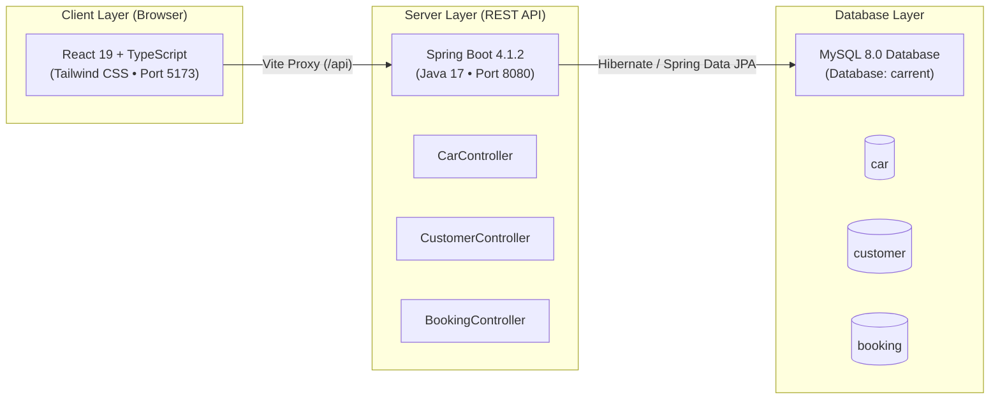

# Wayvero — Car Rental Management System

> **College B.Tech Computer Science & Engineering (CSE) Capstone Project**  
> Full-Stack Web Application • Spring Boot REST API + React & TypeScript + MySQL 8  
> UI & Design System Crafted in **Google Stitch** (Dark Luxury Automobile Theme)

---

## 1. Project Overview

**Wayvero** is an enterprise-grade, full-stack car rental management system tailored for luxury and passenger automobile rentals across Kerala (Kochi, Bolgatty Wharf, Munnar, and Trivandrum). The application provides end-to-end vehicle discovery, customer authentication with BCrypt security, dynamic reservation pricing with optional concierge chauffeurs, live fleet availability synchronization, and a transactional vehicle return workflow.

The user interface was designed in **Google Stitch** and faithfully ported to **React 19**, **TypeScript**, and **Tailwind CSS**, connected directly to an existing **Spring Boot 4** backend without modifying backend code or database schemas.

---

## 2. System Architecture



---

## 3. Technology Stack

| Layer | Technologies Used | Purpose |
| :--- | :--- | :--- |
| **Frontend UI** | **React 19**, **TypeScript**, **Vite 6** | Modern component-driven single-page application |
| **Styling** | **Tailwind CSS v4**, **Google Fonts (Rajdhani, Plus Jakarta Sans)** | Faithful implementation of Google Stitch Dark Luxury Design |
| **Icons** | **Google Material Symbols**, **FontAwesome 6** | Telemetry, vehicle specs, and navigation iconography |
| **Routing** | **React Router v7** (`react-router-dom`) | Client-side routing with `ProtectedRoute` session guards |
| **State Management** | **React Context API** (`AuthContext`) | Customer authentication binding and `localStorage` session |
| **Backend Engine** | **Java 17**, **Spring Boot 4.1.2**, **Spring Web** | REST API endpoints for cars, customers, and bookings |
| **Persistence** | **Spring Data JPA**, **Hibernate** | Object-Relational Mapping (ORM) and entity management |
| **Security** | **Spring Security Crypto** (`BCryptPasswordEncoder`) | One-way cryptographic customer password hashing |
| **Database** | **MySQL 8.0 Community Edition** | Relational storage for cars, customer credentials, and bookings |
| **Proxy Gateway** | **Vite Dev Reverse Proxy** | Forwards `/api` to `localhost:8080`, eliminating CORS without backend changes |

---

## 4. Directory Structure

```text
CarRentalProject/
├── carrent/                           <- Spring Boot Backend (Java 17 + Maven)
│   ├── src/main/java/com/example/
│   │   ├── car/                       <- Car Entity, Repository, Controller, Service
│   │   ├── customer/                  <- Customer Entity, Repository, Controller, Service
│   │   ├── booking/                   <- Booking Entity, Repository, Controller, Service
│   │   └── CarrentApplication.java    <- Spring Boot Application Main Entry
│   ├── src/main/resources/
│   │   └── application.properties     <- MySQL 8 Database Configuration
│   └── mvnw.cmd                       <- Maven Wrapper for Windows
│
├── carrental-frontend/                <- React + TypeScript Frontend (Vite)
│   ├── src/
│   │   ├── api/                       <- Centralized API client (relative /api base)
│   │   ├── components/                <- Navbar, Footer, CarCard, ProtectedRoute
│   │   ├── context/                   <- AuthContext (session state & login/logout)
│   │   ├── pages/                     <- Home, BrowseCars, Register, Login, Booking, Confirmation, MyBookings, 404
│   │   ├── types/                     <- TypeScript interfaces matching real backend JSON
│   │   ├── utils/                     <- Studio car photography lookup & specs
│   │   ├── App.tsx                    <- Route definitions and guards
│   │   └── main.tsx                   <- React root entry
│   ├── TASKS.md                       <- Phase-by-phase task tracking checklist
│   ├── DOCUMENTATION.md               <- Exhaustive college project documentation & examiner defense guide
│   └── vite.config.ts                 <- Dev reverse proxy (/api -> localhost:8080)
│
└── README.md                          <- Project setup and overview guide
```

---

## 5. Prerequisites & Requirements

- **Java**: OpenJDK 17 or Oracle JDK 17 (`java -version`)
- **Node.js**: v18.0.0 or higher (`node -v`, `npm -v`)
- **MySQL**: MySQL Server 8.0 running on `localhost:3306` with database `carrent`
- **Operating System**: Windows 10/11 (PowerShell or Command Prompt)

---

## 6. Step-by-Step Setup & How to Run

### Step 1: Start MySQL Database
Ensure MySQL 8.0 is running and the database `carrent` exists:
```sql
CREATE DATABASE IF NOT EXISTS carrent;
```

### Step 2: Start Spring Boot Backend Server
Open a terminal in the `carrent` directory and launch the server:
```powershell
# Navigate to backend folder
cd "C:\Users\user\Desktop\CarRentalProject\carrent"

# Run Spring Boot via Maven Wrapper
.\mvnw.cmd spring-boot:run
```
*The backend server will start on `http://localhost:8080`.*

### Step 3: Start React Frontend Development Server
Open a second terminal in the `carrental-frontend` directory and start Vite:
```powershell
# Navigate to frontend folder
cd "C:\Users\user\Desktop\CarRentalProject\carrental-frontend"

# Install dependencies (if first time)
npm.cmd install

# Start Vite development server
npm.cmd run dev
```
*The frontend application will be live at `http://localhost:5173`.*

---

## 7. REST API Contract & Specification

All API calls are routed via relative path `/api` forwarded to the backend:

| Method | Endpoint | Request Body | Response | Description |
| :--- | :--- | :--- | :--- | :--- |
| **GET** | `/api/cars` | *None* | `Car[]` | Retrieves all 10 fleet vehicles with live availability |
| **POST** | `/api/customers/register` | `{ name, email, password }` | `{ id, name, email }` | Registers a new customer with BCrypt password hashing |
| **POST** | `/api/customers/login` | `{ email, password }` | `{ id, name, email }` | Authenticates customer against BCrypt hash |
| **POST** | `/api/bookings` | `{ customerId, carId, pickupDate, returnDate, driverRequired }` | `Booking` | Validates dates, calculates price, marks car unavailable, saves booking |
| **GET** | `/api/bookings/customer/{id}` | *None* | `Booking[]` | Retrieves booking history for a specific customer |
| **PUT** | `/api/bookings/{id}/return` | *None* | `Booking` | Marks booking as `RETURNED` and restores car `available = true` |

### Authoritative Pricing Formula
The backend Spring Boot `BookingService` enforces the authoritative pricing formula:
$$\text{Days} = \max(1, \text{days between pickupDate and returnDate})$$
$$\text{Total Price} = \text{Days} \times (\text{car.pricePerDay} + (\text{driverRequired} \ ? \ \text{car.driverChargePerDay} : 0))$$

---

## 8. Demo User Credentials (For Examiner Testing)

Use these pre-registered credentials to test the full flow immediately:
- **Email**: `rahul.nair@example.com`
- **Password**: `Password@123`
- **Customer ID**: `#3`

*(Or click "Create Account" on the registration page to register a new customer in seconds).*

---

## 9. End-to-End User Journey

1. **Browse Fleet (`/cars`)**: Search, filter by vehicle class (SUV, Sedan, Hatchback, MPV), and view real-time availability badges.
2. **Register & Login (`/register`, `/login`)**: Secure onboarding with validation and redirect memory.
3. **Reserve Vehicle (`/book/:carId`)**: Pick pickup and return dates, toggle professional chauffeur, review live estimation and payload preview, and submit.
4. **Authoritative Voucher (`/confirmation/:id`)**: Official receipt reflecting the server-persisted database record with printable voucher.
5. **My Bookings Dashboard (`/bookings`)**: Real-time status badges (`ACTIVE / IN-RENTAL` vs `RETURNED / COMPLETED`).
6. **Return Handover Modal**: Conduct 4-point vehicle inspection checklist and submit `PUT /api/bookings/{id}/return`. The car is instantly restored to `available: true` in the fleet catalog.

---

## 10. Known Architectural Boundaries & Limitations

To maintain absolute academic honesty during viva and evaluation:
1. **Basic Session Binding**: Authentication returns customer details stored in browser `localStorage`. It does not issue a cryptographically signed JWT bearer token.
2. **Global Car Availability**: A car has a binary boolean `available` flag. Overlapping calendar dates are not yet checked (once booked, a car remains unavailable until marked returned).
3. **No Payment Gateway**: Payment transactions and deposit processing are simulated.
4. **No Admin Dashboard**: Fleet modification is available via REST endpoints (`POST /api/cars`), but does not have a dedicated admin UI.

---

## 11. Authors & Academic Credits

- **Project**: Car Rental Management System (Full-Stack College Project)
- **UI Design System**: Google Stitch (Project ID `4159451054062380624`)
- **Backend Architecture**: Spring Boot 4 + MySQL 8.0 + Hibernate JPA
- **Frontend Architecture**: React 19 + TypeScript + Vite + Tailwind CSS v4

