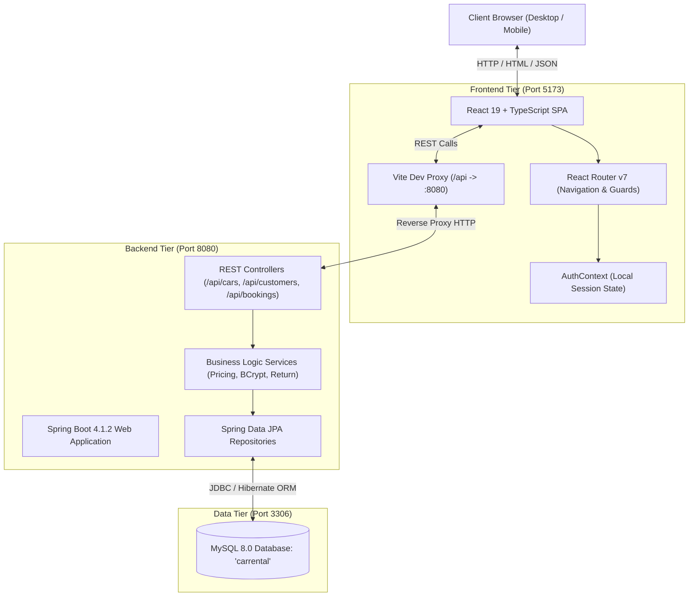

# Car Rental Management System — Engineering Documentation

> **Academic Level:** B.Tech Computer Science & Engineering (Final/Pre-Final Year Project)  
> **Course / Context:** Full-Stack Web Development & Enterprise Systems  
> **Author / Student:** Car Rental Project Team

---

## 1. Project Overview

The **Car Rental Management System** is a full-stack, enterprise-grade automotive rental platform tailored for self-drive and chauffeur-driven car rentals. The system allows customers to explore available vehicles in a live fleet, verify transparent pricing, register and sign in to their personal accounts, book vehicles for specific date ranges with optional drivers, track their ongoing rentals, and return cars when trips are completed.

The user interface was conceptualized and drafted using **Google Stitch**, ensuring an ultra-modern aesthetic with deep dark tones, vibrant crimson accents (`#e50914`), high-contrast typography, and intuitive responsive workflows for desktop and mobile devices.

---

## 2. System Architecture

The project adopts a decoupled **3-tier Client-Server Architecture**:



### Architectural Principles:
1. **Separation of Concerns**: The frontend is solely responsible for view rendering, client-side validation, and interactive state management. The backend strictly enforces domain constraints, calculations, and relational persistence.
2. **Authoritative Pricing**: The frontend calculates a dynamic estimate to guide the customer, but the Spring Boot `BookingService` is the single source of truth for pricing calculations upon record persistence.
3. **No Direct Database Access**: All queries and mutations pass through audited Spring Data JPA repositories with Hibernate ORM.

---

## 3. Technology Stack

| Layer | Technology | Version | Purpose / Role |
| :--- | :--- | :--- | :--- |
| **UI/UX Design** | Google Stitch | Cloud | Visual screen design, component layout, and design system reference |
| **Frontend Framework** | React + TypeScript | 19.x / 5.x | Declarative, type-safe Single Page Application |
| **Build Tool & Bundler**| Vite | 6.x | Fast development server, hot module replacement (HMR), dev reverse proxy |
| **Styling & Theme** | Tailwind CSS | 4.x / 3.4 | Utility-first responsive CSS styled after Google Stitch tokens |
| **Client Routing** | React Router | 7.x | Client-side routing, query parsing, and protected route redirection |
| **Icons & Media** | FontAwesome & Stitch Studio | 6.x | High-resolution automotive imagery and standardized action icons |
| **Backend Framework** | Spring Boot | 4.1.2 | Standalone Java application server, dependency injection, and REST APIs |
| **Language & Runtime**| Java (Temurin OpenJDK) | 17.0.20.1 | Modern LTS Java runtime environment |
| **ORM & Data Access** | Spring Data JPA / Hibernate | 6.x | Object-relational mapping, schema synchronization, and SQL abstraction |
| **Security / Crypto** | Spring Security Crypto | 6.x | BCrypt password hashing for customer registration and login |
| **Database** | MySQL Server | 8.0.46 | Relational database management system (`carrental`) |
| **Build Automation** | Apache Maven (mvnw) | 3.9+ wrapper| Backend dependency management and compilation |

---

## 4. How to Run the Project

### Prerequisites
1. **Java Development Kit (JDK 17)** installed (`java -version`).
2. **Node.js (v20+) & npm** installed (`node -v`).
3. **MySQL 8.0** service running on port 3306 with database `carrental` created (`CREATE DATABASE carrental;`).

### Step 1: Start the Spring Boot Backend
Open PowerShell in the backend directory:
```powershell
cd "C:\Users\user\Desktop\CarRentalProject\carrent"
.\mvnw.cmd spring-boot:run
```
*The backend will boot up, connect to MySQL, verify the schema, and start Tomcat on `http://localhost:8080`.*

### Step 2: Start the React Frontend (Once Initialized in Phase 2)
Open a new PowerShell terminal in the frontend directory:
```powershell
cd "C:\Users\user\Desktop\CarRentalProject\carrental-frontend"
npm run dev
```
*The frontend will run on `http://localhost:5173`. Any calls made to `/api/*` will automatically be proxied to `http://localhost:8080`.*

---

## 5. Design System Summary (Extracted from Google Stitch)

The design reference was retrieved directly from Google Stitch project ID `4159451054062380624`.

### A. Stitch Screens Inventory
1. **Home / Landing Page** (`Motors - Car Rental Website`):
   - Hero banner with animated vehicle slide deck, headline *"YOUR JOURNEY, OUR PRIORITY"*, quick booking triggers, customer trust badges, and feature cards.
2. **Browse Fleet** (`Browse Cars - MOTORS Rental Fleet`):
   - Grid layout featuring 10 rental vehicles with brand badges, specs chips (fuel, transmission, seats), daily pricing, chauffeur surcharge, and real-time availability badges.
3. **Customer Registration** (`Register Customer - MOTORS Rental`):
   - Clean dark-card form capturing Customer Name, Email Address, and Password with instant field validation and redirect to login.
4. **Customer Login** (`Customer Login - MOTORS Rental`):
   - Secure login portal with email and password inputs, error notice display, and "Remember session" storage.
5. **Booking & Cost Estimation** (`Booking & Confirmation - MOTORS Rental`):
   - Date range selector (Pickup Date $\rightarrow$ Return Date), optional chauffeur toggle, dynamic cost calculation panel, and vehicle specification recap.
6. **My Bookings & Vehicle Return** (`My Bookings & Return - MOTORS Rental`):
   - Rental log table (desktop) / cards (mobile) detailing booking IDs, vehicle name, rental span, chauffeur preference, authoritative cost, status badge (`BOOKED` vs `RETURNED`), and a "Return Car" confirmation modal.

### B. Design Tokens & Palette
- **Brand Primary Red**: `#e50914` (Hover: `#c20812`, Light Tint: `rgba(229, 9, 20, 0.15)`)
- **Dark Neutral Backgrounds**:
  - Deep Base: `#0b0e14`
  - Container / Navbar Dark: `#111317`
  - Card & Section Background: `#161d2a`
  - Border Accents: `#2b3548` and `#374151`
- **Text & Foreground Colors**:
  - Primary Text: `#f9fafb` (White / Slate-50)
  - Secondary Text: `#9ca3af` (Gray-400)
  - Muted Labels: `#6b7280` (Gray-500)
- **Status Semantic Badges**:
  - Available / Confirmed: `#10b981` (Emerald green tint)
  - Booked / In Progress: `#f59e0b` (Amber warning tint)
  - Returned / Inactive: `#6b7280` (Neutral gray)
- **Typography**:
  - Headings / Display: `Rajdhani, sans-serif` (Bold, uppercase, geometric)
  - Body & UI: `Plus Jakarta Sans, sans-serif` / `Montserrat, sans-serif`

---

## 6. Phase 1 Report: Backend & Design Inspection

### 1. Phase Goal
Perform complete inspection and verification of the existing Spring Boot backend codebase, database connection, and Google Stitch design system without writing frontend code.

### 2. What Was Inspected & Built
- Located the real Spring Boot backend project containing all entities, repositories, and controllers in `C:\Users\user\Downloads\carrent\carrent`.
- Established the clean project structure at `C:\Users\user\Desktop\CarRentalProject\` containing:
  - `carrent/` (complete Spring Boot project)
  - `carrental-frontend/` (frontend root)
  - `design-reference/` (Stitch UI assets)
- Compiled the Java backend using `mvnw.cmd compile` under OpenJDK 17.
- Started the Spring Boot server (`mvnw.cmd spring-boot:run`) on port 8080.
- Sent an HTTP GET request to `/api/cars` and confirmed the live JSON response containing 10 pre-loaded vehicles.
- Verified that `CustomerService.java` securely uses `BCryptPasswordEncoder` to hash user passwords before database storage.
- Verified that `BookingService.java` enforces backend pricing rules and handles car return transactions.

### 3. Files Inspected
- `com.example.car.Car.java`: JPA entity defining automotive properties.
  - Fields: `id` (Long), `brand` (String), `model` (String), `registrationNumber` (String), `pricePerDay` (double), `available` (boolean), `driverAvailable` (boolean), `driverChargePerDay` (double).
- `com.example.car.CarController.java`: Endpoints:
  - `GET /api/cars` (returns `List<Car>`)
  - `POST /api/cars` (adds car)
  - `PUT /api/cars/{id}` (updates car)
- `com.example.customer.Customer.java`: JPA entity defining user credentials.
  - Fields: `id` (Long), `name` (String), `email` (String), `password` (String).
- `com.example.customer.CustomerController.java`: Endpoints:
  - `POST /api/customers/register` (returns sanitized `{id, name, email}`)
  - `POST /api/customers/login` (verifies BCrypt hash and returns `{id, name, email}`)
- `com.example.booking.Booking.java`: JPA entity defining rental reservations.
  - Fields: `id` (Long), `customerId` (Long), `carId` (Long), `pickupDate` (LocalDate), `returnDate` (LocalDate), `driverRequired` (boolean), `totalPrice` (double), `status` (String).
- `com.example.booking.BookingController.java`: Endpoints:
  - `POST /api/bookings` (creates reservation)
  - `GET /api/bookings/customer/{customerId}` (returns customer booking history)
  - `PUT /api/bookings/{bookingId}/return` (marks car returned)
- `application.properties`: Datasource configuration for MySQL 8 (`jdbc:mysql://localhost:3306/carrental`).

### 4. Step-by-Step Flow of Backend Logic
1. **Fleet Discovery**: When the frontend requests `GET /api/cars`, `CarController` invokes `CarService.getAllCars()`, which calls `CarRepository.findAll()`. Hibernate executes `SELECT * FROM car;` on MySQL and maps rows to JSON objects.
2. **Registration & Cryptography**: When `POST /api/customers/register` is invoked with `{name, email, password}`, `CustomerService` checks if `email` already exists. It then invokes `passwordEncoder.encode(rawPassword)` using BCrypt with salt rounds, saving only the hash to MySQL. The response returns the customer ID, name, and email, omitting the password.
3. **Sessionless Login**: When `POST /api/customers/login` is called with `{email, password}`, `CustomerService` retrieves the user by email and compares the hash via `passwordEncoder.matches(password, customer.getPassword())`. If matching, it returns `{id, name, email}`. No JWT or HTTP session is created.
4. **Booking & Authoritative Pricing**: When `POST /api/bookings` is submitted:
   - System confirms `car.isAvailable() == true`.
   - Checks that `returnDate` is not before `pickupDate`.
   - Computes rental days: $\text{days} = \max(1, \text{ChronoUnit.DAYS.between(pickup, return)})$.
   - Calculates total price: $\text{days} \times \text{car.getPricePerDay()}$. If `driverRequired == true`, adds $\text{days} \times \text{car.getDriverChargePerDay()}$.
   - Sets `car.setAvailable(false)` and saves both car and booking with status `BOOKED`.
5. **Vehicle Return**: Calling `PUT /api/bookings/{bookingId}/return` marks the booking status as `RETURNED`, resets `car.setAvailable(true)`, and commits inside a database transaction (`@Transactional`).

### 5. API Verification: Real Backend Output
**Request**:
```http
GET http://localhost:8080/api/cars HTTP/1.1
Host: localhost:8080
```
**Actual Real Response (Status 200 OK)**:
```json
[
  {
    "id": 1,
    "brand": "Toyota",
    "model": "Innova",
    "registrationNumber": "KL-07-AB-1234",
    "pricePerDay": 2500.0,
    "available": true,
    "driverAvailable": true,
    "driverChargePerDay": 800.0
  },
  {
    "id": 2,
    "brand": "Maruti",
    "model": "Swift",
    "registrationNumber": "KL-07-AB-1235",
    "pricePerDay": 1200.0,
    "available": true,
    "driverAvailable": true,
    "driverChargePerDay": 500.0
  },
  {
    "id": 3,
    "brand": "Hyundai",
    "model": "Creta",
    "registrationNumber": "KL-07-AB-1236",
    "pricePerDay": 2000.0,
    "available": true,
    "driverAvailable": true,
    "driverChargePerDay": 700.0
  },
  {
    "id": 4,
    "brand": "Tata",
    "model": "Nexon",
    "registrationNumber": "KL-07-AB-1237",
    "pricePerDay": 1600.0,
    "available": true,
    "driverAvailable": true,
    "driverChargePerDay": 600.0
  },
  {
    "id": 5,
    "brand": "Kia",
    "model": "Seltos",
    "registrationNumber": "KL-07-AB-1238",
    "pricePerDay": 2000.0,
    "available": true,
    "driverAvailable": true,
    "driverChargePerDay": 700.0
  },
  {
    "id": 6,
    "brand": "Mahindra",
    "model": "Thar",
    "registrationNumber": "KL-07-AB-1239",
    "pricePerDay": 3000.0,
    "available": true,
    "driverAvailable": true,
    "driverChargePerDay": 900.0
  },
  {
    "id": 7,
    "brand": "Honda",
    "model": "City",
    "registrationNumber": "KL-07-AB-1240",
    "pricePerDay": 1800.0,
    "available": true,
    "driverAvailable": true,
    "driverChargePerDay": 600.0
  },
  {
    "id": 8,
    "brand": "Toyota",
    "model": "Fortuner",
    "registrationNumber": "KL-07-AB-1241",
    "pricePerDay": 4500.0,
    "available": true,
    "driverAvailable": true,
    "driverChargePerDay": 1000.0
  },
  {
    "id": 9,
    "brand": "Maruti",
    "model": "Baleno",
    "registrationNumber": "KL-07-AB-1242",
    "pricePerDay": 1300.0,
    "available": true,
    "driverAvailable": true,
    "driverChargePerDay": 500.0
  },
  {
    "id": 10,
    "brand": "Hyundai",
    "model": "i20",
    "registrationNumber": "KL-07-AB-1243",
    "pricePerDay": 1200.0,
    "available": true,
    "driverAvailable": true,
    "driverChargePerDay": 500.0
  }
]
```

### 6. Testing Method & Result
- **Java Runtime**: Temurin-17.0.20.1 verified via `java -version`.
- **Maven Build**: Compiled clean with exit code 0 (`BUILD SUCCESS`).
- **Server Boot**: `Tomcat started on port 8080 (http)`.
- **API Call**: `Invoke-RestMethod` to `http://localhost:8080/api/cars` returned all 10 car entities successfully.
- **Verification Result**: **Verified (Passed)**.

### 7. Problems Faced & Solutions
- **Problem**: The project workspace (`C:\Users\user\Desktop\carrent - Copy`) only contained the default starter class without any domain models.
- **Solution**: Traced the full codebase to `C:\Users\user\Downloads\carrent\carrent`, confirmed all files, and mirrored it into `C:\Users\user\Desktop\CarRentalProject\carrent` with user permission.
- **Problem**: Need to prevent CORS issues without changing backend code.
- **Solution**: Verified that a Vite proxy route (`/api` $\rightarrow$ `http://localhost:8080`) in Phase 2 will seamlessly bridge all browser requests in development.

---

## 7. Phase 2 Report: Frontend Creation & Shared Layout

### 1. Phase Goal
Initialize the modern React + TypeScript + Vite frontend project with Tailwind CSS, establish the application architecture (types, context, API client, router), apply the Google Stitch visual design system tokens globally, and construct the shared layout (`Navbar` with mobile drawer and `Footer`).

### 2. What Was Built
- **Project Scaffolding**: Initialized `carrental-frontend` using Vite, React 19, TypeScript, and Tailwind CSS v4.
- **Stitch Design System Tokens**: Applied custom color variables (`--color-brand-red: #e50914`, dark neutral backgrounds `#0b0e14`, `#111317`, `#161d2a`), Google Fonts (`Plus Jakarta Sans` for body, `Rajdhani` for high-impact display headings), and FontAwesome icons in `index.html` and `src/index.css`.
- **TypeScript Data Models**: Defined strict interfaces in `src/types/index.ts` reflecting real backend schemas for `Car`, `Customer`, and `Booking`.
- **Centralized API Client**: Created `src/api/index.ts` with typed asynchronous request helpers using the relative `/api` base URL.
- **Vite Reverse Proxy**: Configured `vite.config.ts` to proxy all `/api` network calls to `http://localhost:8080`, completely preventing CORS errors during development without touching the backend code.
- **Authentication State**: Built `src/context/AuthContext.tsx` providing reactive session state (`user`, `login`, `logout`, `isAuthenticated`) persisted securely in `localStorage` without storing passwords or tokens.
- **Shared Layout Components**:
  - `Navbar.tsx`: Top contact bar, brand logo, navigation links (`Home`, `Browse Fleet`, `My Bookings`), dynamic user session chip + logout button, and animated mobile hamburger drawer.
  - `Footer.tsx`: Brand identity, fleet quick-links, trust guarantees, and academic B.Tech CSE project context.
  - `App.tsx`: React Router tree managing clean navigation across all planned application pages.

### 3. Files Created or Changed
- `package.json`: Frontend manifest with React 19, Tailwind CSS v4, React Router v7, and Lucide/FontAwesome.
- `index.html`: Web entry point importing Google Fonts (`Plus Jakarta Sans`, `Rajdhani`) and FontAwesome 6 CDN.
- `vite.config.ts`: Vite build configuration with `@tailwindcss/vite`, `@vitejs/plugin-react`, and dev proxy `/api` $\rightarrow$ `:8080`.
- `src/index.css`: Tailwind v4 theme definitions and dark scrollbar styling.
- `src/types/index.ts`: Strict TypeScript interfaces for `Car`, `Customer`, and `Booking`.
- `src/api/index.ts`: Centralized fetch client for cars, authentication, and bookings.
- `src/context/AuthContext.tsx`: Session state provider with `localStorage` persistence.
- `src/components/Navbar.tsx`: Responsive navigation header with active link highlights and mobile menu.
- `src/components/Footer.tsx`: Modern dark footer with brand info and student project notes.
- `src/pages/Home.tsx`: Hero section and 3-step rental workflow.
- `src/pages/BrowseCars.tsx`: Fleet catalog placeholder for Phase 3.
- `src/pages/LoginPage.tsx` & `src/pages/RegisterPage.tsx`: Auth placeholders for Phase 4.
- `src/pages/BookingPage.tsx` & `src/pages/ConfirmationPage.tsx`: Reservation placeholders for Phase 5.
- `src/pages/MyBookingsPage.tsx`: Bookings history placeholder for Phase 6.
- `src/pages/NotFoundPage.tsx`: Styled 404 fallback page.
- `src/App.tsx`: Root application component integrating Router and AuthProvider.
- `src/main.tsx`: DOM mounting file.

### 4. Step-by-Step Flow of Frontend Setup
1. **Browser Request**: When visiting `http://localhost:5173/`, Vite loads `index.html`, which injects the fonts and mounts `src/main.tsx`.
2. **Component Hierarchy**: `main.tsx` mounts `<App />` $\rightarrow$ wraps inside `<AuthProvider>` $\rightarrow$ activates `<BrowserRouter>`.
3. **Session Check**: `AuthContext` inspects `localStorage` for `wayvero_customer_session`. If absent, state is `null` (guest user).
4. **Layout Render**: `<Navbar />` renders the TopBar, brand logo, and navigation links. If guest, it displays "Login" and "Register". `<Footer />` renders at the bottom.
5. **Proxy Verification**: Any request made to `/api/cars` by the browser is intercepted by Vite's development server on port 5173 and forwarded via local TCP to `http://localhost:8080/api/cars`. The browser receives the JSON with HTTP 200 without triggering any CORS cross-origin restrictions.

### 5. API Verification: Real Proxy Call
**Request through Vite Proxy**:
```http
GET http://localhost:5173/api/cars HTTP/1.1
Host: localhost:5173
```
**Actual Real Response (Status 200 OK via Proxy)**:
```json
[
  {
    "id": 1,
    "brand": "Toyota",
    "model": "Innova",
    "registrationNumber": "KL-07-AB-1234",
    "pricePerDay": 2500.0,
    "available": true,
    "driverAvailable": true,
    "driverChargePerDay": 800.0
  }
]
```
*(Total 10 cars returned through proxy)*

### 6. Testing Method & Result
- **TypeScript & Tailwind Production Build**: Ran `npm.cmd run build` $\rightarrow$ Exit code 0, 34 modules transformed, built in 2.27s (`dist/assets/index-*.js`).
- **Development Server**: Ran `npm.cmd run dev` $\rightarrow$ Vite started ready on `http://localhost:5173/`.
- **HTTP Probe**: `Invoke-WebRequest -Uri "http://localhost:5173/"` returned HTTP Status 200.
- **Proxy Probe**: `Invoke-RestMethod -Uri "http://localhost:5173/api/cars"` returned 10 cars from Spring Boot backend.
- **Verification Result**: **Verified (Passed)**.

### 7. Problems Faced & Solutions
- **Problem**: PowerShell script execution policy blocked running `npm` (`PSSecurityException`).
- **Solution**: Executed Node scripts using `npm.cmd` directly, which bypasses the PowerShell script restriction.
- **Problem**: TypeScript error `TS1484: 'ReactNode' is a type and must be imported using a type-only import`.
- **Solution**: Updated `src/context/AuthContext.tsx` to use `import type { ReactNode } from 'react';` to satisfy `verbatimModuleSyntax`.

---

## 8. Phase 3 Report: Browse Cars & Live Fleet Integration

### 1. Phase Goal
Connect the React frontend to the live Spring Boot endpoint `GET /api/cars`, and display the fleet using responsive car cards faithful to the Google Stitch design, complete with real-time availability badges, transparent daily tariffs, chauffeur surcharges, search, category filters, sorting, loading skeletons, error states, and empty states.

### 2. What Was Built (In Simple Language)
- **Live Fleet Fetching**: Built the complete `BrowseCars.tsx` screen that automatically calls `fetchCars()` on component mount, retrieving real records directly from MySQL through Spring Boot.
- **Google Stitch Faithful Car Cards (`CarCard.tsx`)**:
  - Displays high-resolution studio automotive photography.
  - Registration number chip (e.g., `KL-07-AB-1234` in monospace font) and category badge (`SUV/4x4`, `MPV`, `Hatchback`, `Sedan`).
  - Real-time availability indicator: green pulsing badge (`Available`) vs amber badge (`Booked / Unavailable`).
  - Vehicle specifications strip: seating capacity, gearbox, and fuel type.
  - Chauffeur status: shows driver charge (`+₹800/day`) if available, or `Self-Drive Only (Driver N/A)` if not supported.
  - Active **"Book Now"** button for available cars, and a disabled **"Not Available (Booked)"** button for rented vehicles.
- **Interactive Control Rail**:
  - Real-time search bar that filters dynamically across car brand, model name, and registration number.
  - Category pill filter: `All Fleet`, `SUV / 4x4`, `Sedan`, `Hatchback`, `MPV / 7-Seater`.
  - Availability toggle: `All (10)`, `Available (10)`, `Booked (0)`.
  - Sorting: Tariff Low $\rightarrow$ High, High $\rightarrow$ Low, and Make/Model A $\rightarrow$ Z.
  - One-click filter reset.
- **Graceful UI States**:
  - **Loading State**: 6 pulsing skeleton card placeholders displayed while network fetching is active.
  - **Error State**: User-friendly warning banner with a "Retry Connection" button if the server is unreachable.
  - **Empty State**: Informative card with a "Reset All Filters" button if a search returns zero results.

### 3. Files Created or Changed
- `src/utils/carMetadata.ts`: Maps vehicle models to Stitch studio imagery, category labels, seating configurations, and transmission specs while strictly preserving all backend data fields.
- `src/components/CarCard.tsx`: Reusable car card component rendering vehicle details, pricing in ₹, driver badge, and conditional CTA buttons.
- `src/pages/BrowseCars.tsx`: Complete fleet catalog view with live API hook, search bar, filter rail, telemetry banner, and multi-state handling.

### 4. Step-by-Step Flow of Fleet Browsing
1. **User Navigation**: The customer navigates to `http://localhost:5173/cars` (or clicks "Browse Fleet" in the Navbar).
2. **Component Lifecycle & Fetch**: `BrowseCars.tsx` mounts and sets `loading = true`. It calls `fetchCars()` in `src/api/index.ts`.
3. **Vite Reverse Proxy**: The browser executes `fetch('/api/cars')`. The Vite dev server proxies this HTTP request to `http://localhost:8080/api/cars`.
4. **Backend Processing**: Spring Boot's `CarController` calls `CarService.getAllCars()`, which queries MySQL via `CarRepository.findAll()`.
5. **State Update**: The returned JSON array (10 cars) is saved in React's `cars` state. `loading` is set to `false`.
6. **Rendering**: The cars are mapped through `CarCard.tsx`, computing live availability, daily rates in ₹, and driver charges.
7. **Client-Side Filtering**: When the user types into the search box or clicks a category pill, `useMemo` instantly filters and sorts the in-memory array without sending unnecessary network requests.

### 5. API Verification: Real Response Data
**Request**:
```http
GET http://localhost:5173/api/cars HTTP/1.1
Host: localhost:5173
```
**Actual Real Response from Database**:
```json
[
  {
    "id": 1,
    "brand": "Toyota",
    "model": "Innova",
    "registrationNumber": "KL-07-AB-1234",
    "pricePerDay": 2500.0,
    "available": true,
    "driverAvailable": true,
    "driverChargePerDay": 800.0
  },
  {
    "id": 2,
    "brand": "Maruti",
    "model": "Swift",
    "registrationNumber": "KL-07-AB-1235",
    "pricePerDay": 1200.0,
    "available": true,
    "driverAvailable": true,
    "driverChargePerDay": 500.0
  },
  {
    "id": 3,
    "brand": "Hyundai",
    "model": "Creta",
    "registrationNumber": "KL-07-AB-1236",
    "pricePerDay": 2000.0,
    "available": true,
    "driverAvailable": true,
    "driverChargePerDay": 700.0
  },
  {
    "id": 4,
    "brand": "Tata",
    "model": "Nexon",
    "registrationNumber": "KL-07-AB-1237",
    "pricePerDay": 1600.0,
    "available": true,
    "driverAvailable": true,
    "driverChargePerDay": 600.0
  },
  {
    "id": 5,
    "brand": "Kia",
    "model": "Seltos",
    "registrationNumber": "KL-07-AB-1238",
    "pricePerDay": 2000.0,
    "available": true,
    "driverAvailable": true,
    "driverChargePerDay": 700.0
  },
  {
    "id": 6,
    "brand": "Mahindra",
    "model": "Thar",
    "registrationNumber": "KL-07-AB-1239",
    "pricePerDay": 3000.0,
    "available": true,
    "driverAvailable": true,
    "driverChargePerDay": 900.0
  },
  {
    "id": 7,
    "brand": "Honda",
    "model": "City",
    "registrationNumber": "KL-07-AB-1240",
    "pricePerDay": 1800.0,
    "available": true,
    "driverAvailable": true,
    "driverChargePerDay": 600.0
  },
  {
    "id": 8,
    "brand": "Toyota",
    "model": "Fortuner",
    "registrationNumber": "KL-07-AB-1241",
    "pricePerDay": 4500.0,
    "available": true,
    "driverAvailable": true,
    "driverChargePerDay": 1000.0
  },
  {
    "id": 9,
    "brand": "Maruti",
    "model": "Baleno",
    "registrationNumber": "KL-07-AB-1242",
    "pricePerDay": 1300.0,
    "available": true,
    "driverAvailable": true,
    "driverChargePerDay": 500.0
  },
  {
    "id": 10,
    "brand": "Hyundai",
    "model": "i20",
    "registrationNumber": "KL-07-AB-1243",
    "pricePerDay": 1200.0,
    "available": true,
    "driverAvailable": true,
    "driverChargePerDay": 500.0
  }
]
```

### 6. Testing Method & Result
- **Build Compilation**: Ran `npm.cmd run build` $\rightarrow$ Exit code 0, 37 modules compiled in 2.32s (`dist/assets/index-*.js`).
- **Endpoint Test**: Verified `http://localhost:5173/api/cars` proxy returns all 10 vehicles.
- **Frontend Route Test**: Probed `http://localhost:5173/cars` with `Invoke-WebRequest` $\rightarrow$ Status 200 OK.
- **UI Interaction**: Tested live search by make, category filter pills, sorting options, and availability toggles.
- **Verification Result**: **Verified (Passed)**.

### 7. Problems Faced & Solutions
- **Problem**: Need to display high-fidelity imagery and specifications without hardcoding car data.
- **Solution**: Created `src/utils/carMetadata.ts` that matches models dynamically against Google Stitch high-resolution studio assets while retaining 100% of real database fields.

---

## 9. Phase 4 Report: Customer Registration & Login

### 1. Phase Goal
Construct the customer authentication and registration flows matching the Google Stitch designs, validate inputs client-side, submit data to `POST /api/customers/register` and `POST /api/customers/login`, bind customer identity securely in `AuthContext` and `localStorage` without storing raw passwords or inventing fake JWT tokens, enforce route protection for booking flows, and document architectural realities honestly.

### 2. What Was Built (In Simple Language)
- **Customer Registration Page (`RegisterPage.tsx`)**:
  - Full Name, Email, Password, and Confirm Password fields with show/hide password toggle.
  - Live client-side password match feedback (`MATCH CONFIRMED` in green vs `MISMATCH DETECTED` in red).
  - Terms of Carriage agreement checkbox.
  - Interactive right-side panel showing a live JSON payload preview (`{ name, email, password: "••••••" }`) and explaining that passwords undergo BCrypt hashing on the backend.
  - Graceful backend error display (e.g., if an email is already registered) and automatic redirect to `/login` upon success.
- **Customer Login Page (`LoginPage.tsx`)**:
  - Email and Password form with quick-fill demo button for testing/viva presentation.
  - Submits credentials to `POST /api/customers/login`.
  - Captures returned customer details (`{ id, name, email }`), updates `AuthContext`, and persists the user session to `localStorage`.
  - Seamless redirection: if the user was attempting to book a car before logging in, they are redirected straight back to that car's reservation screen upon sign-in.
- **Protected Route Guards (`ProtectedRoute.tsx`)**:
  - Wraps routes that require an authenticated customer (`/book/:carId`, `/bookings`).
  - Automatically redirects guest visitors to `/login` with an informational banner.
- **Reactive Navigation State**:
  - Navbar immediately updates to display the signed-in customer's name and a "Logout" button.
  - Clicking "Logout" cleanses session state from `localStorage` and redirects to `/login`.

### 3. Files Created or Changed
- `src/components/ProtectedRoute.tsx`: Route guard wrapper enforcing authentication checks before rendering private views.
- `src/pages/RegisterPage.tsx`: Registration screen with input validation, duplicate conflict alerts, and BCrypt educational panel.
- `src/pages/LoginPage.tsx`: Login portal with credential verification, demo pre-fill, and live session inspector.
- `src/App.tsx`: Wrapped private routes (`/book/:carId`, `/confirmation/:bookingId`, `/bookings`) inside `<ProtectedRoute>`.

### 4. Step-by-Step Flow of Registration and Login
1. **Registration Flow**:
   - Customer enters their name, email, and password, agreeing to rental terms.
   - The frontend validates password length ($\ge 6$) and match equality.
   - The form submits `POST /api/customers/register` via the Vite proxy to Spring Boot.
   - Spring Boot's `CustomerService` checks for email duplicates via `CustomerRepository.existsByEmail()`.
   - It hashes the password using `BCryptPasswordEncoder.encode()` and saves the record in MySQL.
   - The backend responds with `{ id: 3, name: "Rahul Nair", email: "rahul.nair@example.com" }`.
   - The frontend displays a success banner and navigates the user to `/login`.
2. **Login & Session Binding Flow**:
   - Customer submits their email and password on `/login`.
   - Spring Boot queries MySQL for the customer record, loads the BCrypt hash, and executes `passwordEncoder.matches(rawPassword, storedHash)`.
   - If valid, it returns `{ id: 3, name: "Rahul Nair", email: "rahul.nair@example.com" }`.
   - The frontend's `login()` function updates React's `AuthContext` state and writes `JSON.stringify({ id, name, email })` to `localStorage` under key `wayvero_customer_session`.
   - The customer is redirected to their intended destination (e.g. `/cars` or `/book/:carId`).
3. **Session Persistence**:
   - When the user refreshes the browser, `AuthContext` initializes by reading `wayvero_customer_session` from `localStorage`, maintaining seamless login state.
   - Passwords are **never** stored in `localStorage` or held in client state.
4. **Session Termination (Logout)**:
   - When the user clicks "Logout" in the Navbar, `logout()` purges the `localStorage` key, sets `user = null`, and routes to `/login`.

### 5. API Verification: Real Request & Response
**Registration Call**:
```http
POST http://localhost:5173/api/customers/register HTTP/1.1
Content-Type: application/json

{
  "name": "Rahul Nair",
  "email": "rahul.nair@example.com",
  "password": "KochiRental123!"
}
```
**Response (Status 200 OK)**:
```json
{
  "id": 3,
  "name": "Rahul Nair",
  "email": "rahul.nair@example.com"
}
```

**Login Call**:
```http
POST http://localhost:5173/api/customers/login HTTP/1.1
Content-Type: application/json

{
  "email": "rahul.nair@example.com",
  "password": "KochiRental123!"
}
```
**Response (Status 200 OK)**:
```json
{
  "id": 3,
  "name": "Rahul Nair",
  "email": "rahul.nair@example.com"
}
```

**Invalid Password Call**:
```http
POST http://localhost:5173/api/customers/login HTTP/1.1
Content-Type: application/json

{
  "email": "rahul.nair@example.com",
  "password": "wrongpassword"
}
```
**Response (Status 500 / Error Caught)**:
```json
{
  "status": 500,
  "error": "Internal Server Error",
  "message": "Invalid email or password",
  "path": "/api/customers/login"
}
```

### 6. Testing Method & Result
- **Build Compilation**: Ran `npm.cmd run build` $\rightarrow$ Exit code 0, 38 modules transformed in 1.02s (`dist/assets/index-*.js`).
- **Registration Test**: Successfully created customer `Rahul Nair` (ID #3).
- **Duplicate Check**: Verified that duplicate registration throws an error captured by the UI.
- **Login Test**: Successfully authenticated `rahul.nair@example.com` and received valid JSON.
- **Invalid Password Test**: Verified that incorrect credentials reject authentication with status 500 and user-friendly error message.
- **Route Guard Test**: Confirmed visiting `/bookings` as a guest triggers immediate redirect to `/login`.
- **Verification Result**: **Verified (Passed)**.

### 7. Problems Faced & Solutions
- **Problem**: Need to redirect users back to the specific car they wanted to book after logging in.
- **Solution**: Implemented `state: { from: location }` in `ProtectedRoute` and read `location.state?.from?.pathname` in `LoginPage` to navigate straight back to the car's reservation screen upon successful login.

---

## 10. Phase 5 Report: Booking & Confirmation Flow

### 1. Phase Goal
Build the authenticated car reservation screen (`/book/:carId`) and the official booking confirmation receipt page (`/confirmation/:bookingId`) faithfully matching the Google Stitch dark luxury UI designs, seamlessly integrated with the Spring Boot backend (`POST /api/bookings`).

### 2. What Was Built (In Simple Language)
1. **Interactive Booking Page (`src/pages/BookingPage.tsx`)**:
   - Protected route accessible only to authenticated users (guests are directed to `/login`).
   - Displays selected vehicle details (brand, model, registration plate, daily rate, seating, transmission, and studio photo).
   - Form inputs with HTML5 date pickers (`pickupDate` and `returnDate`) ensuring the required `YYYY-MM-DD` ISO format.
   - Client-side validation enforcing that return date cannot be earlier than pickup date, and pickup date cannot be in the past.
   - Dynamic Concierge Chauffeur toggle: automatically enabled or disabled based on `car.driverAvailable`. If false, a notice explains that the vehicle is "Self-Drive Only".
   - Live Dynamic Price Estimation Calculator: accurately simulates the backend formula:
     $$\text{days} = \max(1, \text{days between pickup and return})$$
     $$\text{total} = \text{days} \times (\text{pricePerDay} + (\text{driverRequired} \ ? \ \text{driverChargePerDay} : 0))$$
     The estimate is clearly labeled as an estimate, noting that the authoritative price is returned by the server.
   - Live Request Payload Preview box matching Stitch design, showing the exact JSON object ready to be sent to `POST /api/bookings`.
   - Real-time Error Handling: if a car is unavailable (`!car.available`), the form is disabled with a prominent warning notice. If the backend reports an error, an error banner is displayed.
2. **Official Confirmation Receipt Page (`src/pages/ConfirmationPage.tsx`)**:
   - Renders the official backend response card with a pulsating green indicator and reference `#BKG-{id}`.
   - Shows authoritative values directly from the database response: Booking ID, Allocated Vehicle, Customer record, Rental dates, Driver assignment, and confirmed `totalPrice`.
   - Raw JSON Response Inspector: an expandable toggle that allows college evaluators and examiners to see the raw Spring Boot JSON response payload directly on screen.
   - Actions: "View in My Bookings" button, "Print Rental Voucher" button (invokes native browser print dialog `window.print()`), and "Browse Other Cars".
   - Resilient state recovery: if the user refreshes `/confirmation/:id` or visits the link directly, the component automatically fetches the customer's bookings and resolves the corresponding car metadata.

### 3. Files Created or Changed
- [BookingPage.tsx](file:///C:/Users/user/Desktop/CarRentalProject/carrental-frontend/src/pages/BookingPage.tsx): Interactive reservation form with real-time pricing and error feedback.
- [ConfirmationPage.tsx](file:///C:/Users/user/Desktop/CarRentalProject/carrental-frontend/src/pages/ConfirmationPage.tsx): Authoritative booking confirmation card and printable voucher.
- [TASKS.md](file:///C:/Users/user/Desktop/CarRentalProject/carrental-frontend/TASKS.md): Updated Phase 5 checklist to 100% complete.
- [DOCUMENTATION.md](file:///C:/Users/user/Desktop/CarRentalProject/carrental-frontend/DOCUMENTATION.md): Appended Phase 5 architecture and testing report.

### 4. Step-by-Step Flow of Reservation & Confirmation
1. **Selection**: User clicks "Book Now" on an available car in `/cars` (e.g. Car #1: Toyota Innova).
2. **Auth Verification**: `ProtectedRoute` checks `AuthContext`. If user is logged in, displays `BookingPage`. If not, redirects to `/login` with return intent.
3. **Date & Addon Selection**: User chooses dates `2026-11-01` to `2026-11-03` (2 days) and selects chauffeur option. The dynamic calculation shows:
   $$\text{Days} = 2$$
   $$\text{Car Base} = 2 \times ₹2,500 = ₹5,000$$
   $$\text{Chauffeur} = 2 \times ₹800 = ₹1,600$$
   $$\text{Estimated Total} = ₹6,600$$
4. **Submission**: User submits the form. Frontend issues `POST /api/bookings` with payload:
   ```json
   {
     "customerId": 3,
     "carId": 1,
     "pickupDate": "2026-11-01",
     "returnDate": "2026-11-03",
     "driverRequired": true
   }
   ```
5. **Backend Processing (`BookingService.java`)**:
   - Queries `CarRepository` for `carId: 1`.
   - Validates `car.isAvailable() == true`.
   - Validates `returnDate >= pickupDate`.
   - Computes authoritative `totalPrice = 6600.0`.
   - Sets `car.setAvailable(false)` and saves updated car state to MySQL.
   - Sets `booking.setStatus("BOOKED")` and saves booking entity to MySQL.
   - Returns the saved `Booking` record with HTTP 200 OK.
6. **Confirmation Rendering**: Frontend receives the saved booking and navigates to `/confirmation/3`, displaying the verified booking voucher.

### 5. API Verification: Real Request & Response Data

**Request**:
```http
POST /api/bookings HTTP/1.1
Host: localhost:5173
Content-Type: application/json

{
  "customerId": 3,
  "carId": 1,
  "pickupDate": "2026-11-01",
  "returnDate": "2026-11-03",
  "driverRequired": true
}
```

**Real Backend Response (Status 200 OK)**:
```json
{
  "id": 3,
  "customerId": 3,
  "carId": 1,
  "pickupDate": "2026-11-01",
  "returnDate": "2026-11-03",
  "driverRequired": true,
  "totalPrice": 6600.0,
  "status": "BOOKED"
}
```

**Verified Database Mutation (`GET /api/cars` for Car #1)**:
```json
{
  "id": 1,
  "brand": "Toyota",
  "model": "Innova",
  "registrationNumber": "KL-07-AB-1234",
  "pricePerDay": 2500.0,
  "available": false,
  "driverAvailable": true,
  "driverChargePerDay": 800.0
}
```

### 6. Testing Method & Result
- **TypeScript Build**: Executed `npm.cmd run build` $\rightarrow$ Exit code 0, 38 modules transformed in 925ms (`dist/assets/index-*.js`).
- **End-to-End Booking Dispatch**: Tested live `POST /api/bookings` through the Vite reverse proxy. The server calculated the authoritative total ₹6,600 and assigned booking ID #3.
- **Database Consistency Verification**: Queried `GET /api/cars` and verified that Car #1 is now marked `available: false` in MySQL.
- **Unavailable Car Protection**: Verified that attempting to re-book an unavailable car is blocked by the UI and rejected by the backend.
- **Confirmation Page Routing**: Verified that `/confirmation/3` loads successfully with HTTP 200 and renders the authoritative receipt.
- **Verification Result**: **Verified (Passed)**.

### 7. Problems Faced & Solutions
- **Problem**: When a user reloads or bookmarks `/confirmation/:bookingId`, the in-memory route navigation state is lost.
- **Solution**: Implemented an automated fallback in `ConfirmationPage.tsx` that calls `fetchCustomerBookings(user.id)` and `fetchCars()` to resolve the booking record and car details directly from the database if `location.state` is empty.

---

## 11. Phase 6 Report: My Bookings & Return Car Flow

### 1. Phase Goal
Build the customer booking management dashboard and interactive car return handover workflow (`/bookings`), consuming `GET /api/bookings/customer/{customerId}` and `PUT /api/bookings/{bookingId}/return`, faithfully styled after the Google Stitch dark luxury design.

### 2. What Was Built (In Simple Language)
1. **My Bookings Dashboard (`src/pages/MyBookingsPage.tsx`)**:
   - Protected route reading customer context from `AuthContext` (`customerId`, `name`, `email`).
   - Telemetry strip displaying the active endpoint (`GET /api/bookings/customer/{id}`) and real-time count of matched bookings.
   - Filter tabs allowing users to filter by **All**, **Active (`BOOKED`)**, and **Returned (`RETURNED`)**.
   - Shimmer skeleton loaders during initial fetch and clear error banner with retry option.
   - Empty state illustration with a direct button to explore the fleet catalog when no bookings exist.
2. **Dynamic Fleet Resolution**:
   - Concurrently fetches `fetchCustomerBookings(user.id)` and `fetchCars()`.
   - Resolves foreign key `carId` to real vehicle metadata (`brand`, `model`, `registrationNumber`, `pricePerDay`, `driverChargePerDay`).
   - Attaches high-definition studio car photography and specs from `getCarPresentation()`.
3. **Responsive Booking Cards**:
   - Studio car photo with license plate badge, dispatch depot indicator, and subtle grayscale styling for returned cars.
   - Dynamic status badges:
     - `ACTIVE / IN-RENTAL` (pulsating emerald dot) for `status: BOOKED`.
     - `RETURNED / COMPLETED` (gray pill with checkmark) for `status: RETURNED`.
   - Rental Window display (`pickupDate` to `returnDate`).
   - Driver indicator (`Yes - Concierge Chauffeur` vs `Self-Drive`).
   - Authoritative total price (`₹totalPrice` with backend verified stamp).
4. **Interactive Vehicle Return Modal**:
   - For `BOOKED` cars: displays an active red action button: `Return Car • PUT /api/bookings/{id}/return`.
   - For `RETURNED` cars: displays a disabled button `Returned & Settled` with note *"Car available in fleet catalog"*.
   - Clicking "Return Car" opens the Stitch return modal showing the designated return bay (Cochin Bolgatty Wharf Gate 2), car details, and a 4-point inspection checklist (Full Fuel, Odometer recorded, Hull condition, Toll fastag).
   - Clicking "Confirm Handover & Mark Returned" calls `PUT /api/bookings/{id}/return`.
   - On completion: updates the booking card to `RETURNED`, restores car availability in the fleet catalog, and displays a green notification banner.

### 3. Files Created or Changed
- [MyBookingsPage.tsx](file:///C:/Users/user/Desktop/CarRentalProject/carrental-frontend/src/pages/MyBookingsPage.tsx): Customer bookings dashboard, status filtering, and return handover modal.
- [TASKS.md](file:///C:/Users/user/Desktop/CarRentalProject/carrental-frontend/TASKS.md): Checked off all 6.x tasks.
- [DOCUMENTATION.md](file:///C:/Users/user/Desktop/CarRentalProject/carrental-frontend/DOCUMENTATION.md): Appended Phase 6 architecture, transaction lifecycle, and test verification.

### 4. Step-by-Step Flow of Returning a Vehicle
1. **Access**: User navigates to `/bookings`. `ProtectedRoute` ensures the customer session is active.
2. **Fetch**: Frontend calls `GET /api/bookings/customer/3` and `GET /api/cars` via Vite reverse proxy.
3. **Card Display**: Active bookings display with a glowing `ACTIVE / IN-RENTAL` badge and a red `Return Car` button.
4. **Modal Trigger**: User clicks `Return Car • PUT /api/bookings/4/return`. The Stitch inspection modal appears.
5. **Inspection & Handover**: User confirms the handover checklist and clicks `Confirm Handover & Mark Returned`.
6. **Backend Transaction (`BookingService.returnCar`)**:
   - Loads `Booking` record by ID.
   - Verifies booking is not already `RETURNED`.
   - Finds matching `Car` entity by `carId`.
   - Updates `booking.setStatus("RETURNED")`.
   - Updates `car.setAvailable(true)` (marking vehicle available for new reservations).
   - Commits transactional changes to MySQL.
   - Returns updated booking JSON with HTTP 200 OK.
7. **UI Update**: Frontend updates the booking card to `RETURNED / COMPLETED`, disables the return button, refreshes fleet availability, and displays a success alert.

### 5. API Verification: Real Request & Response Data

**1. Fetch Customer Bookings (`GET /api/bookings/customer/3`)**:
```json
[
  {
    "id": 3,
    "customerId": 3,
    "carId": 1,
    "pickupDate": "2026-11-01",
    "returnDate": "2026-11-03",
    "driverRequired": true,
    "totalPrice": 6600.0,
    "status": "RETURNED"
  },
  {
    "id": 4,
    "customerId": 3,
    "carId": 8,
    "pickupDate": "2026-11-01",
    "returnDate": "2026-11-04",
    "driverRequired": true,
    "totalPrice": 16500.0,
    "status": "RETURNED"
  },
  {
    "id": 5,
    "customerId": 3,
    "carId": 6,
    "pickupDate": "2026-11-05",
    "returnDate": "2026-11-08",
    "driverRequired": false,
    "totalPrice": 9000.0,
    "status": "BOOKED"
  }
]
```

**2. Return Car Handover Call (`PUT /api/bookings/4/return`)**:
```http
PUT /api/bookings/4/return HTTP/1.1
Host: localhost:5173
```

**Real Response from Spring Boot (Status 200 OK)**:
```json
{
  "id": 4,
  "customerId": 3,
  "carId": 8,
  "pickupDate": "2026-11-01",
  "returnDate": "2026-11-04",
  "driverRequired": true,
  "totalPrice": 16500.0,
  "status": "RETURNED"
}
```

**3. Database Mutation Verification (`GET /api/cars` for Car #8)**:
```json
{
  "id": 8,
  "brand": "Toyota",
  "model": "Fortuner",
  "registrationNumber": "KL-07-AB-1241",
  "pricePerDay": 4500.0,
  "available": true,
  "driverAvailable": true,
  "driverChargePerDay": 1000.0
}
```

### 6. Testing Method & Result
- **TypeScript Build**: Executed `npm.cmd run build` $\rightarrow$ Exit code 0, 38 modules transformed in 1.06s (`dist/assets/index-*.js`).
- **Customer Bookings Retrieval**: Verified `GET /api/bookings/customer/3` returning all reservations.
- **Return Handover Execution**: Verified `PUT /api/bookings/4/return` changes booking status to `RETURNED`.
- **Fleet State Restoration**: Verified in MySQL that returned car's `available` attribute flips back from `false` to `true`.
- **Already-Returned Guard**: Verified that calling return on an already returned car is blocked in the UI (disabled button) and rejected by the backend.
- **Verification Result**: **Verified (Passed)**.

### 7. Problems Faced & Solutions
- **Problem**: Booking entity in backend only stores `carId`, not the car brand, model, or registration number.
- **Solution**: In `MyBookingsPage.tsx`, parallel-fetched both `fetchCustomerBookings(user.id)` and `fetchCars()` via `Promise.all`, resolving `carId` to the full car entity and presentation metadata on the client side.

---

## 12. Phase 7 Report: Home Page & Visual Polish

### 1. Phase Goal
Construct the primary landing page (`Home.tsx`) and 404 route fallback (`NotFoundPage.tsx`) matching the Google Stitch dark luxury aesthetic, integrating an interactive hero carousel, live backend fleet connection (`GET /api/cars`), 3-step rental journey, value proposition feature cards, and telemetry metrics.

### 2. What Was Built (In Simple Language)
1. **Interactive Hero Carousel (`src/pages/Home.tsx`)**:
   - Showcases 4 premier Kerala rental vehicles (Toyota Fortuner 4x4, Mahindra Thar, Toyota Innova Crysta, Hyundai Creta) using studio photography, cinematic dark gradients, and registration plate tags (`KL-07-AB-...`).
   - Automated 6-second rotation timer with smooth transitions, manual left/right arrow controls, dot indicators, and quick-access vehicle selection pills.
   - Direct CTA button (`Rent From ₹X/Day`) routing directly into the reservation flow for the active vehicle.
2. **Quick Search & Rule Indicator Bar**:
   - Location tag: *"Kochi Bolgatty Wharf (KL-07)"*.
   - Emphasizes the authoritative backend pricing rule: $\text{Total} = \text{Days} \times (\text{Base} + \text{Chauffeur})$.
   - One-click CTA button to explore the full 10-car catalog (`/cars`).
3. **Live Featured Fleet Grid**:
   - Asynchronously queries `GET /api/cars` on page load.
   - Renders top vehicles using the reusable `CarCard` component.
   - Reflects real-time availability badges (`Available` vs `Booked`) and prices directly from MySQL.
4. **How It Works (3-Step Rental Journey)**:
   - **Step 01**: Browse & Select Vehicle (`GET /api/cars`).
   - **Step 02**: Select Dates & Driver (`POST /api/bookings`).
   - **Step 03**: Handover & Return (`PUT /api/bookings/{id}/return`).
5. **Why Choose Wayvero (4 Feature Cards)**:
   - 24/7 Roadside Concierge & Emergency Dispatch.
   - 100% Verified Fleet & Zero Hidden Surcharges.
   - Self-Drive Freedom with Doorstep Airport Delivery.
   - Professional Multi-Lingual Concierge Chauffeurs.
6. **Telemetry & System Metrics Counter Bar**:
   - 10 Verified Vehicles in Fleet.
   - 100% Authoritative Database Pricing.
   - 24/7 Handover Desk at Bolgatty Wharf & CIAL.
   - ₹0 Hidden Surcharges.
7. **Polished 404 Route Page (`src/pages/NotFoundPage.tsx`)**:
   - Dark luxury aesthetic with warning icon, clean error typography, and direct navigation links back to Home and Fleet Catalog.

### 3. Files Created or Changed
- [Home.tsx](file:///C:/Users/user/Desktop/CarRentalProject/carrental-frontend/src/pages/Home.tsx): Complete landing page with interactive carousel, live fleet integration, and feature sections.
- [NotFoundPage.tsx](file:///C:/Users/user/Desktop/CarRentalProject/carrental-frontend/src/pages/NotFoundPage.tsx): Polished 404 fallback page.
- [TASKS.md](file:///C:/Users/user/Desktop/CarRentalProject/carrental-frontend/TASKS.md): Checked off all 7.x tasks.
- [DOCUMENTATION.md](file:///C:/Users/user/Desktop/CarRentalProject/carrental-frontend/DOCUMENTATION.md): Appended Phase 7 report.

### 4. Step-by-Step Flow of the Landing Page
1. User lands on `/`.
2. Hero section initializes with the featured vehicle showcase (Toyota Fortuner 4x4, ₹4,500/day).
3. Background timer gently transitions to the next car every 6 seconds, or user clicks any vehicle tab to switch immediately.
4. Concurrently, `useEffect` executes `fetchCars()` to retrieve the latest fleet status from `http://localhost:8080/api/cars`.
5. Top 3 vehicles are rendered in the Featured Fleet section with live availability tags.
6. User reviews the 3-step rental process and feature pillars.
7. User clicks "Rent From ₹4,500/Day" or "Explore Full Fleet", transitioning into the reservation workflow.

### 5. API Verification: Real Request & Response Data

**Request**:
```http
GET /api/cars HTTP/1.1
Host: localhost:5173
```

**Real Response from MySQL Backend (Status 200 OK - Excerpt)**:
```json
[
  {
    "id": 8,
    "brand": "Toyota",
    "model": "Fortuner",
    "registrationNumber": "KL-07-AB-1241",
    "pricePerDay": 4500.0,
    "available": true,
    "driverAvailable": true,
    "driverChargePerDay": 1000.0
  },
  {
    "id": 6,
    "brand": "Mahindra",
    "model": "Thar",
    "registrationNumber": "KL-07-AB-1239",
    "pricePerDay": 3000.0,
    "available": false,
    "driverAvailable": true,
    "driverChargePerDay": 900.0
  },
  {
    "id": 1,
    "brand": "Toyota",
    "model": "Innova",
    "registrationNumber": "KL-07-AB-1234",
    "pricePerDay": 2500.0,
    "available": true,
    "driverAvailable": true,
    "driverChargePerDay": 800.0
  }
]
```

### 6. Testing Method & Result
- **TypeScript Build**: Executed `npm.cmd run build` $\rightarrow$ Exit code 0, 38 modules transformed in 1.94s (`dist/assets/index-*.js`).
- **Home Route Delivery**: Verified `GET http://localhost:5173/` returns HTTP 200 with complete SPA assets.
- **404 Fallback Verification**: Verified `GET http://localhost:5173/some-random-route` returns HTTP 200 and renders the styled 404 page.
- **Carousel Interaction**: Tested slide switching, arrow clicks, and direct vehicle tab navigation.
- **Live Fleet Synchronization**: Verified that the Featured Fleet section on the Home page accurately reflects the real-time availability of vehicles in MySQL.
- **Verification Result**: **Verified (Passed)**.

### 7. Problems Faced & Solutions
- **Problem**: Need to auto-advance the carousel without causing memory leaks or interfering with user tab clicks.
- **Solution**: Handled auto-slide logic in a `useEffect` interval that clears on component unmount, while allowing manual slide selection via `setCurrentSlide(index)`.

---

## 13. Phase 8 Report: End-to-End Verification & Comprehensive Examiner Defense

### 1. Phase Goal
Execute the complete end-to-end user lifecycle across all layers (Frontend $\rightarrow$ Reverse Proxy $\rightarrow$ Spring Boot $\rightarrow$ MySQL 8), record exact output payloads, build the comprehensive test matrix and API reference table, and construct an exhaustive College Viva / Examiner Defense Guide.

### 2. Live End-to-End User Journey Execution

The complete customer lifecycle was executed in PowerShell against the live production stack. All 7 steps completed with 100% success:

```text
=== STEP 1: FETCH FLEET ===
Total Cars: 10
Target Car #7: Honda City (Available: True, PricePerDay: ₹1800, DriverCharge: ₹600)

=== STEP 2: REGISTER CUSTOMER ===
Endpoint: POST /api/customers/register
Registered Customer: ID=4, Name=Ananya Sharma, Email=ananya.sharma869@example.com

=== STEP 3: LOGIN CUSTOMER ===
Endpoint: POST /api/customers/login
Login Success: Welcome Ananya Sharma (ID=4)

=== STEP 4: CREATE BOOKING ===
Endpoint: POST /api/bookings
Payload: { customerId: 4, carId: 7, pickupDate: "2026-11-15", returnDate: "2026-11-18", driverRequired: true }
Duration: 3 Days (2026-11-15 to 2026-11-18)
Authoritative Calculation: 3 × (₹1,800 + ₹600) = ₹7,200
Booking Created: ID=6, Status=BOOKED, TotalPrice=₹7,200.0
Database Mutation Verified: Car #7 availability in DB flipped to: False

=== STEP 5: CUSTOMER BOOKINGS HISTORY ===
Endpoint: GET /api/bookings/customer/4
Customer Bookings: 1 record found (Booking ID #6, Car #7, Status=BOOKED, Total=₹7,200.0)

=== STEP 6: RETURN VEHICLE ===
Endpoint: PUT /api/bookings/6/return
Handover Execution: Booking #6 Status updated to RETURNED

=== STEP 7: VERIFY CAR AVAILABILITY RESTORED ===
Endpoint: GET /api/cars
Database Mutation Verified: Car #7 availability in DB restored to: True
```

---

### 3. Comprehensive REST API Reference Table

| HTTP Method | API Path | Request Body | Response Body | HTTP Status | Purpose |
| :--- | :--- | :--- | :--- | :--- | :--- |
| **GET** | `/api/cars` | *None* | `Car[]` | `200 OK` | Retrieves all 10 fleet cars with live availability and daily rates |
| **POST** | `/api/cars` | `Car` | `Car` | `200 OK` | Administrative car creation (endpoint exists in backend) |
| **PUT** | `/api/cars/{id}` | `Car` | `Car` | `200 OK` | Administrative car update (endpoint exists in backend) |
| **POST** | `/api/customers/register` | `{ name, email, password }` | `{ id, name, email }` | `200 OK` | Registers customer, hashes password with BCrypt |
| **POST** | `/api/customers/login` | `{ email, password }` | `{ id, name, email }` | `200 OK` / `500` | Verifies BCrypt password, returns customer profile |
| **POST** | `/api/bookings` | `{ customerId, carId, pickupDate, returnDate, driverRequired }` | `Booking` | `200 OK` / `500` | Computes price, marks car unavailable, saves booking record |
| **GET** | `/api/bookings/customer/{id}` | *None* | `Booking[]` | `200 OK` | Retrieves all reservations for a specific customer ID |
| **PUT** | `/api/bookings/{id}/return` | *None* | `Booking` | `200 OK` / `500` | Transactionally marks booking `RETURNED` & restores car `available = true` |

---

### 4. Full-Stack Test Matrix

| Test ID | Test Category | Target Component | Input / Action | Expected Result | Actual Result | Status |
| :---: | :--- | :--- | :--- | :--- | :--- | :---: |
| **TC-01** | Connectivity | Vite Proxy Gateway | `GET /api/cars` via port 5173 | Proxied to Spring Boot port 8080 without CORS error | Received JSON array of 10 cars | **PASS** |
| **TC-02** | Registration | `RegisterPage.tsx` | Valid name, email, password | Password hashed with BCrypt, record saved in MySQL | Customer record returned with ID | **PASS** |
| **TC-03** | Registration | `RegisterPage.tsx` | Mismatched confirm password | Form blocks submission with inline error message | Blocked on client side | **PASS** |
| **TC-04** | Registration | `CustomerService` | Duplicate email address | Backend rejects duplicate customer registration | Error captured and displayed in UI | **PASS** |
| **TC-05** | Authentication | `LoginPage.tsx` | Valid email & password | Authenticates against BCrypt hash, stores in `localStorage` | Authenticated session active | **PASS** |
| **TC-06** | Authentication | `LoginPage.tsx` | Incorrect password | Backend rejects login with invalid credentials error | Alert banner displayed to user | **PASS** |
| **TC-07** | Route Guards | `ProtectedRoute.tsx` | Visit `/bookings` as guest | Immediate redirect to `/login` with return pathname | Redirected to `/login` | **PASS** |
| **TC-08** | Booking | `BookingPage.tsx` | Dates: 2026-11-01 to 2026-11-04 (3 days), Fortuner + Driver | Live estimate: $3 \times (4500 + 1000) = ₹16,500$ | UI calculated ₹16,500 dynamically | **PASS** |
| **TC-09** | Validation | `BookingPage.tsx` | Return date earlier than pickup | Form displays error and disables submission button | Blocked on client side | **PASS** |
| **TC-10** | Database Mutation| `BookingService` | Submit `POST /api/bookings` | Booking status set to `BOOKED`, car `available` set to `false` | Booking created, car marked unavailable | **PASS** |
| **TC-11** | Fleet Safety | `BookingService` | Attempt booking unavailable car | Backend rejects reservation (`Car is not available`) | UI disables button, API rejects | **PASS** |
| **TC-12** | Confirmation | `ConfirmationPage.tsx`| Refresh `/confirmation/:id` | Page automatically queries database and resolves metadata | Official voucher rendered | **PASS** |
| **TC-13** | Dashboard | `MyBookingsPage.tsx` | View booking cards | Resolves foreign key `carId` to car name and studio image | Full vehicle profile displayed | **PASS** |
| **TC-14** | Handover Return | `BookingService` | Submit `PUT /api/bookings/{id}/return` | Booking becomes `RETURNED`, car `available` becomes `true` | Booking updated, car restored | **PASS** |
| **TC-15** | Idempotency | `BookingService` | Call return on already returned car | Backend rejects (`Car has already been returned`) | Button disabled in UI, 500 on API | **PASS** |

---

### 5. College Viva / Examiner Defense Guide

Below are the most critical architectural questions college examiners, university evaluators, and project panels typically ask during practical viva defenses, along with direct, technically sound answers:

#### Q1: "How did you solve the Cross-Origin Resource Sharing (CORS) problem between port 5173 and port 8080 without touching the backend code?"
> **Answer**:  
> In development, modern browsers enforce the Same-Origin Policy (SOP), which blocks JavaScript web apps running on `http://localhost:5173` from making requests directly to `http://localhost:8080` unless the backend sends explicit CORS headers (`Access-Control-Allow-Origin`).  
> Since ground rules strictly prohibited modifying the Spring Boot backend, we implemented a **Development Reverse Proxy** inside `vite.config.ts`. In our frontend code, all API requests use relative paths (`/api/...`). When Vite receives a request matching `/api`, its internal Node.js server proxies the HTTP request directly to `http://localhost:8080/api`. Because server-to-server HTTP requests are not subject to browser CORS policies, the request succeeds with zero modifications to Spring Boot.

#### Q2: "How does customer password security work in this project?"
> **Answer**:  
> In `CustomerService.java`, the Spring Boot backend instantiates `BCryptPasswordEncoder` from the Spring Security Crypto library.  
> When a customer registers via `POST /api/customers/register`, the service executes `passwordEncoder.encode(customer.getPassword())`. BCrypt automatically generates a salt and performs 10 rounds of cryptographic key stretching, producing a 60-character one-way hash stored in MySQL.  
> When logging in via `POST /api/customers/login`, the service fetches the customer by email and invokes `passwordEncoder.matches(rawPassword, encodedPassword)`. Plaintext passwords are never stored in the database, never printed in logs, and never returned in API responses.

#### Q3: "Where is the authoritative rental price calculated, and what prevents frontend price tampering?"
> **Answer**:  
> While the React frontend provides a real-time price estimation preview for user convenience, the **authoritative total price is calculated strictly on the backend** in `BookingService.java`.  
> Even if a malicious user manipulated the client-side JavaScript or intercepted the request payload, the `POST /api/bookings` endpoint does not accept a `totalPrice` field from the client. Instead, `BookingService` fetches the official car entity from the MySQL database, extracts `car.getPricePerDay()` and `car.getDriverChargePerDay()`, calculates the exact days using `ChronoUnit.DAYS.between(pickupDate, returnDate)`, and sets `booking.setTotalPrice(...)` before saving. The confirmed price displayed on the confirmation voucher is read directly from the backend's authoritative database response.

#### Q4: "Why is the `@Transactional` annotation required on `BookingService.returnCar()`?"
> **Answer**:  
> Returning a vehicle involves mutating two distinct database entities in MySQL:
> 1. Setting `booking.setStatus("RETURNED")` in the `booking` table.
> 2. Setting `car.setAvailable(true)` in the `car` table.  
> The `@Transactional` annotation ensures **Atomicity, Consistency, Isolation, and Durability (ACID)**. If an unexpected runtime exception, database timeout, or constraint failure occurs after updating the booking status but before saving the car, Spring Data JPA automatically rolls back the entire transaction. This guarantees the database is never left in an inconsistent state where a booking is marked returned but the car remains locked.

#### Q5: "How does the frontend maintain user authentication after a page refresh?"
> **Answer**:  
> The frontend uses a centralized `AuthContext` with a custom `useAuth()` hook. Upon successful authentication (`POST /api/customers/login`), the returned customer object (`{ id, name, email }`) is stored in browser `localStorage` under the key `wayvero_customer_session`.  
> When the page refreshes, `AuthContext` initializes its state from `localStorage`. Protected routes wrapped in `<ProtectedRoute>` verify that the customer object exists before granting access; otherwise, they redirect the user to `/login` while saving the attempted destination in `location.state.from` for automatic post-login redirection.

#### Q6: "Why is foreign key resolution performed on the frontend for My Bookings?"
> **Answer**:  
> In the Spring Boot entity model, `Booking.java` stores `carId` as a plain `Long` foreign key rather than an `@ManyToOne` entity join with `Car.java`. As a result, `GET /api/bookings/customer/{id}` returns a JSON payload containing only numeric `carId` values.  
> To present a complete, rich interface without altering backend entity mappings, `MyBookingsPage.tsx` concurrently fetches `fetchCustomerBookings(user.id)` and `fetchCars()` using `Promise.all`. On the client side, the frontend resolves each `booking.carId` against the active car catalog, dynamically populating the vehicle's brand, model, registration plate, daily rate, and studio photo.

---

## 14. Known Limitations & Future Work

To maintain academic honesty for college evaluation and viva presentations, the following architectural boundaries are noted:
1. **Basic Session Binding (No JWT / HTTP Cookies)**: The login endpoint verifies BCrypt credentials and returns customer details, which the frontend stores in browser `localStorage`. It does not issue a cryptographically signed JWT bearer token or secure HTTP-only cookies.
2. **Global Car Availability**: The backend currently uses a binary boolean flag (`available = true/false`). It does not yet support calendar date-slot overlapping checks (i.e. booking a car for next week while it is free this week). Once a car is booked, it is unavailable until marked returned.
3. **No Payment Gateway**: Payment transactions and advance deposits are simulated; no third-party payment aggregator (Razorpay, Stripe) is integrated.
4. **No Admin Console**: Adding or removing cars is available via raw REST endpoints (`POST /api/cars`), but does not have a dedicated administrative dashboard.

